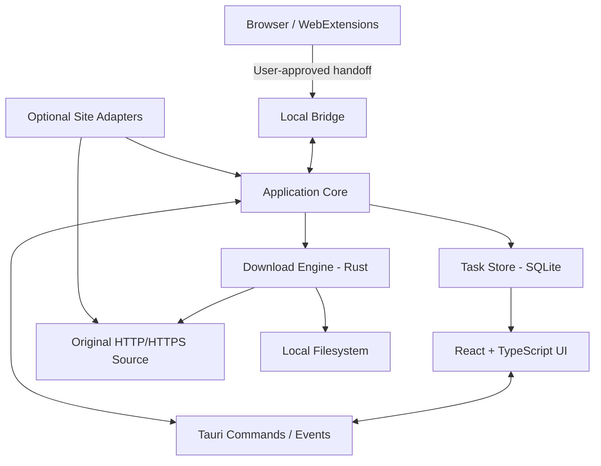
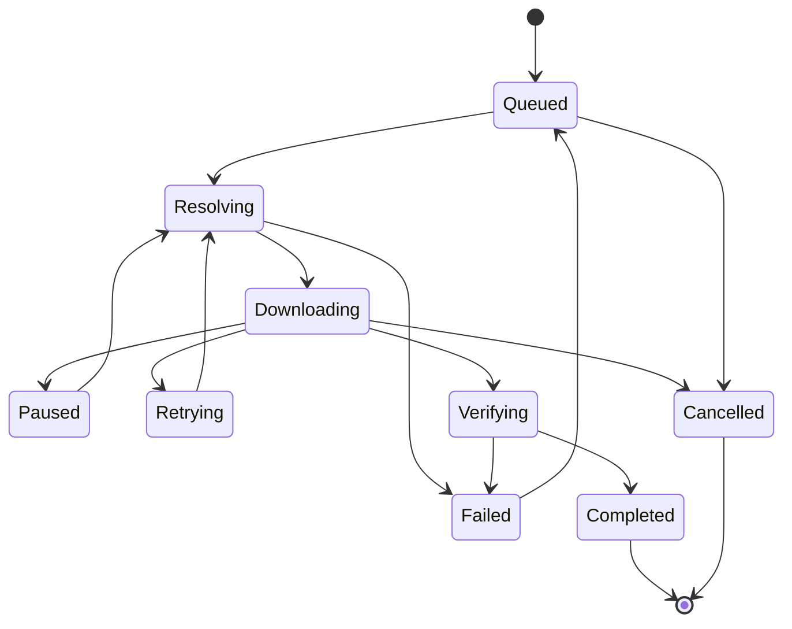

# DownloadOS System Design

**Status:** Initial architecture baseline  
**Target:** Windows first; architecture should remain portable to macOS  
**Principle:** Local-first, direct-to-source transfers, modular site integrations

## 1. Purpose and non-goals

### Purpose
DownloadOS is a desktop download manager for ordinary file downloads, resumable transfer management, queueing, and browser handoff. The design leaves room for optional, isolated integrations for supported media websites.

### Non-goals for the MVP
- Guaranteeing that every website or every video is downloadable.
- A cloud proxy that relays user downloads.
- Collecting users' website passwords.
- Exporting all browser cookies to the desktop app or a server.
- Bypassing DRM, paywalls, access controls, or platform restrictions.
- Cloud synchronization, user accounts, team management, and subscriptions in the first milestone.
- macOS distribution/signing as a blocker for the Windows MVP.

## 2. Design principles

1. **Local-first:** task history, preferences, and downloaded files remain local unless the user explicitly chooses otherwise.
2. **Direct downloads:** the app connects to the original host; DownloadOS servers do not relay file bytes.
3. **Separation of concerns:** UI, engine, persistence, bridge, and adapters are independent modules.
4. **Correctness over speed claims:** segmented downloads are used only when range behavior is verified.
5. **Fail safely:** unsupported auth or media flows produce a clear explanation.
6. **Least privilege:** browser permissions and Tauri capabilities are narrow.
7. **Observable behavior:** state transitions, errors, and retries are explicit and testable.

## 3. High-level architecture



The bridge and app must validate every message and must not treat browser-provided URLs as trusted.

## 4. Proposed repository layout

```text
DownloadOS/
├── CLAUDE.md
├── README.md
├── package.json
├── src/                         # React UI
│   ├── app/
│   ├── components/
│   ├── features/
│   │   ├── downloads/
│   │   ├── queue/
│   │   └── settings/
│   ├── lib/
│   └── types/
├── src-tauri/
│   ├── Cargo.toml
│   ├── tauri.conf.json
│   ├── capabilities/
│   └── src/
│       ├── main.rs
│       ├── commands/
│       ├── app_core/
│       ├── download_engine/
│       ├── task_store/
│       ├── browser_bridge/
│       ├── site_adapters/
│       └── security/
├── extension-chromium/
│   ├── manifest.json
│   ├── src/
│   └── tests/
├── tests/
│   ├── fixtures/
│   └── integration/
└── docs/
```

Claude Code may adjust this layout to match the generated Tauri starter, but must preserve the module boundaries and document deviations.

## 5. Main components

### 5.1 Desktop UI
Responsibilities:
- Show active, queued, paused, completed, and failed downloads.
- Add a URL, choose a destination, and confirm the filename.
- Display real progress, speed, and estimated time only when meaningful.
- Expose pause, resume, cancel, retry, reveal-in-folder, and remove-history actions.
- Show clear unsupported/authorization errors.
- Never own transfer logic or write downloaded bytes directly.

### 5.2 Tauri command/event layer
Responsibilities:
- Expose narrow commands such as `create_download`, `pause_download`, `resume_download`, `cancel_download`, `list_downloads`, and `get_download_details`.
- Validate inputs and return structured errors.
- Emit progress/state events to the UI.
- Use explicit Tauri capabilities and a restrictive content security policy.
- Avoid a generic “execute arbitrary command” API.

### 5.3 Download engine
Responsibilities:
- Resolve a direct HTTP/HTTPS resource.
- Perform HEAD or bounded GET probing where appropriate; servers may not implement HEAD correctly.
- Detect byte-range support using actual response behavior.
- Download a single stream or bounded parallel segments.
- Coordinate cancellation, retries, pause, and resume.
- Validate response lengths and final output.
- Write only to an approved destination path.
- Never parse or execute downloaded content.

### 5.4 Task store
Responsibilities:
- Persist task IDs, source URL (with sensitive query values redacted in logs), destination, filename, state, byte counts, timestamps, retry state, ETag/Last-Modified when useful, and segment checkpoints.
- Use schema migrations.
- Use transactions for state changes.
- Avoid storing browser credentials or full cookie jars.
- Treat signed URLs as secrets; minimize persistence and redact them from UI logs.

### 5.5 Browser extension and bridge
Responsibilities:
- Detect ordinary links/media only with appropriate user consent and browser permissions.
- Offer “Send to DownloadOS” as an explicit action.
- Send a structured request to the local app.
- Show whether the desktop app is available and explain failed handoffs.
- Never send passwords or a full cookie jar.
- Do not silently capture browsing history or upload URLs to a remote service.

The bridge should use an established secure local mechanism. Prefer browser native messaging where supported. If using a loopback listener, bind only to loopback, require explicit pairing and short-lived scoped tokens, validate Origin and request schema, impose request-size/rate limits, and reject non-loopback access.

### 5.6 Site adapters
Responsibilities:
- Support a specific site and content type using an allowed, maintainable method.
- Declare prerequisites and known limitations.
- Use official APIs or supported download/export mechanisms where available.
- Avoid bypassing DRM or access restrictions.
- Keep site-specific logic out of the core engine.
- Be independently testable and disableable.

An adapter may discover that a website uses an unsupported adaptive stream or protected media. It must return `Unsupported` rather than pretending it has a direct file URL.

## 6. Download state machine



Rules:
- State transitions must be centralized and validated.
- Pausing is cooperative; the engine must stop scheduling new work and safely checkpoint active work.
- A task is complete only after all expected bytes are written and required validation passes.
- A retry must be bounded and classified; permanent authorization or unsupported errors must not loop indefinitely.
- After restart, recover to a safe queued/resolving state unless saved transfer metadata is still valid.

## 7. HTTP transfer design

### Single-stream mode
- Stream response chunks to a temporary file.
- Update progress from actual bytes written.
- Enforce configured size and time limits.
- Cancel cleanly and preserve or remove partial files according to explicit policy.

### Segmented mode
- First establish a trustworthy total size and verify byte-range behavior.
- Use `Range` requests and require valid `206 Partial Content` responses with matching `Content-Range`.
- Bound segment count, concurrency, memory, and open file handles.
- Ensure each segment maps to a non-overlapping byte interval.
- Detect changed ETag/Last-Modified or inconsistent lengths; restart safely rather than combining bytes from different versions.
- If any segment behavior is inconsistent, stop segmented mode and fall back to single-stream mode when safe.
- Do not assume a server supports ranges because it advertises `Accept-Ranges`.

### Resume
- Save URL/resource identity, destination, expected size, validator metadata, and verified segment checkpoints.
- If the URL expires, do not blindly retry forever. Request a fresh user-authorized resolution where supported.
- If the resource changes, restart rather than corrupting the final file.
- Use a temporary file and atomic rename when supported by the platform/filesystem.

## 8. Security model

Threats include malicious URLs, malicious websites, local bridge abuse, path traversal, corrupt range responses, secret leakage, and hostile downloads.

Controls:
- Allow only `http` and `https` for network downloads by default.
- Reject unsupported schemes such as `file:`, `javascript:`, and arbitrary custom protocols.
- Validate each redirect and final destination against SSRF policy.
- Block loopback, private, link-local, and cloud metadata IP ranges where applicable; account for DNS rebinding and redirects.
- Do not allow browser content to choose arbitrary filesystem paths without user approval.
- Sanitize filenames and normalize destination paths.
- Never overwrite files silently.
- Limit connection count, file size where configured, retries, and resource use.
- Redact credentials, cookies, authorization headers, and signed query tokens from logs.
- Never execute downloaded files.
- Use minimal Tauri permissions and a restrictive CSP.
- Treat all adapter output as untrusted.

## 9. Data model (initial)

### DownloadTask
- `id`: UUID/string
- `source_url`: secret-aware persisted value; never log raw signed query strings
- `display_url`: redacted display form
- `filename`: sanitized final name
- `destination_path`: user-approved path
- `state`: enum
- `total_bytes`: optional integer
- `downloaded_bytes`: integer
- `mode`: single/segmented
- `etag`: optional
- `last_modified`: optional
- `retry_count`: integer
- `created_at`, `updated_at`: timestamps
- `last_error_code`: optional structured code

### Segment
- `task_id`
- `segment_index`
- `start_byte`
- `end_byte`
- `verified_bytes`
- `state`

Avoid persisting credentials. Store only what is needed to safely resume.

## 10. Error taxonomy

Use stable error codes, not raw strings alone:
- `INVALID_URL`
- `UNSUPPORTED_SCHEME`
- `NETWORK_ERROR`
- `HTTP_STATUS`
- `AUTH_REQUIRED`
- `AUTH_EXPIRED`
- `RANGE_UNSUPPORTED`
- `RANGE_INVALID`
- `RESOURCE_CHANGED`
- `DISK_FULL`
- `PERMISSION_DENIED`
- `DESTINATION_EXISTS`
- `CANCELLED`
- `UNSUPPORTED_MEDIA`
- `POLICY_RESTRICTED`
- `INTERNAL_ERROR`

User messages should be understandable; detailed diagnostics must redact secrets.

## 11. Cross-platform plan

### Windows MVP
- Develop/test on Windows.
- Package via Tauri's supported Windows installer targets.
- Validate Windows path rules, long filenames, reserved names, and file locking.
- Code signing is recommended for public distribution.

### macOS
- Keep business logic platform-independent.
- Validate Keychain integration only if secrets become necessary.
- Test app lifecycle, permissions, file paths, notifications, and background behavior on a real Mac or macOS CI runner.
- Public distribution may require Developer ID signing and notarization.
- Do not claim macOS support based only on a successful Windows build.

## 12. Future optional services
Not required for core downloads:
- Product website and documentation
- Release distribution and update manifest
- License verification
- Optional account/subscription backend
- Crash reporting only with clear consent and redaction

The backend must never proxy ordinary download traffic by default.
